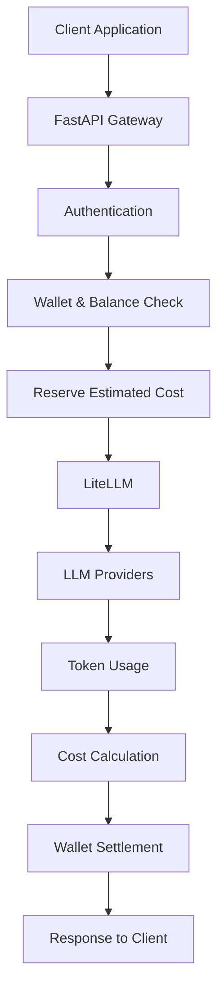

# TokenLedger-Mini Prepaid LLM Gateway

## What is TokenLedger?

I'm building a small version of a prepaid LLM gateway designed for businesses in India.
The basic idea is simple: instead of managing separate API integrations and billing for different AI models, users can access multiple LLM providers through a single API and pay using a prepaid wallet.

Users add money to their wallet, make AI requests, and get charged based on the actual tokens consumed.

## How does it work?

1. A user sends an API request with their API key.
2. The gateway checks the user's wallet balance.
3. It reserves an estimated amount before processing the request.
4. LiteLLM routes the request to the selected AI model.
5. Once the response is received, the gateway calculates the actual token cost.
6. The wallet is settled accordingly, and any unused reserved amount is refunded.

The system is designed to prevent users from spending more than their available balance, even when multiple requests arrive simultaneously.

## Architecture

## Core Features

- **Unified LLM Gateway:** Access multiple AI models through one API.
- **Prepaid Wallet:** Users spend only from their available balance.
- **Token Metering:** Track token consumption and calculate request costs.
- **Reserve & Settle:** Reserve estimated costs and reconcile them against actual usage.
- **Concurrency Safety:** Prevent multiple simultaneous requests from overspending a wallet.
- **Idempotency:** Avoid duplicate charges when requests are retried.
- **INR Billing:** Maintain monetary values in integer paise and explore GST-aware invoicing.

## Tech Stack

- **Python** – Core programming language.
- **FastAPI** – Backend API framework.
- **LiteLLM** – Integration and routing across LLM providers.
- **PostgreSQL** – Persistent storage for users, wallets, and transaction records.
- **Redis** – Fast balance checks, counters, and rate limiting.
- **SQLAlchemy & Alembic** – Database operations and migrations.
- **Pytest** – Testing, including concurrent wallet requests.
- **Javascript** - For Frontend.

## Project Goal

This is a learning-focused student project through which I'm exploring real-world backend engineering concepts such as API gateways, financial transaction handling, concurrency, database consistency, and AI infrastructure.
The goal is not just to build another API, but to understand how an LLM gateway can manage model access, usage, and money reliably.
Ritik Raushan - Final Year Cse Student.
